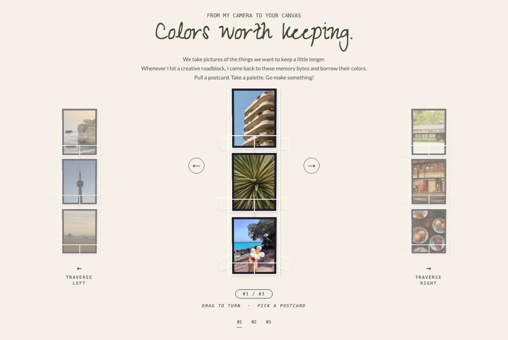
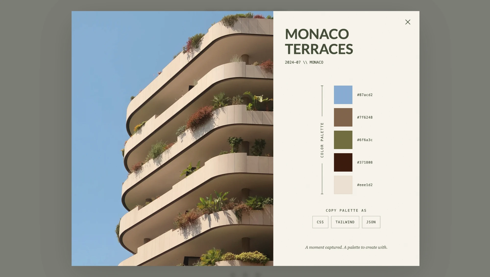
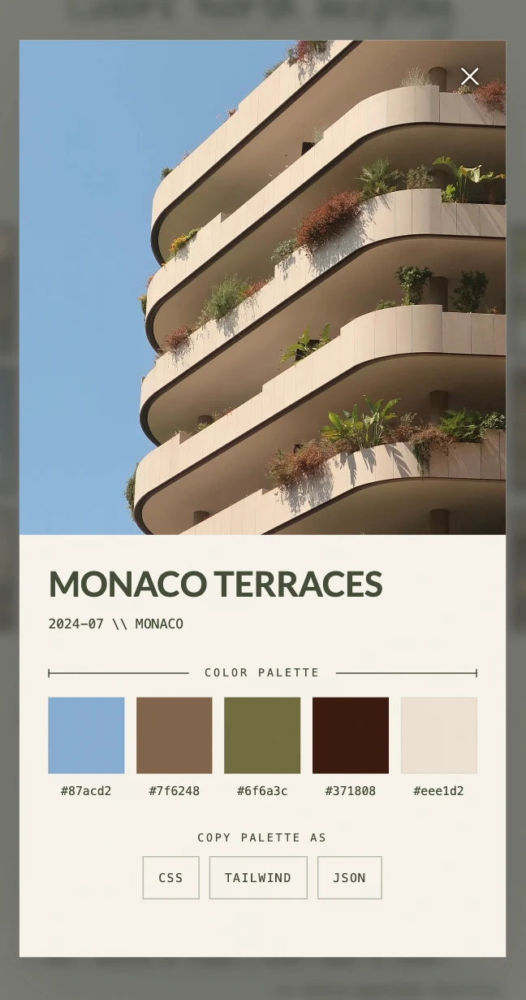

# Color keepsakes

We take pictures of the things we want to keep a little longer. This is a small archive of mine: photos from my camera roll, each paired with a five-color palette I picked by hand, displayed on spinning wire postcard racks like the ones in a souvenir shop.

Pull a postcard. Take a palette. Go make something.

**Live site: [wishyouwerehue.vercel.app](https://wishyouwerehue.vercel.app)**



<table>
  <tr>
    <td align="center">
      
    </td>
    <td align="center">
      
    </td>
  </tr>
  <tr>
    <td align="center">
      <sub>Postcard UI Color Palette (Desktop)</sub>
    </td>
    <td align="center">
      <sub>Postcard UI Color Palette (Mobile)</sub>
    </td>
  </tr>
</table>

## What it does

- **Postcard racks.** Three-sided wire racks built in CSS 3D. Drag, swipe, or use the arrow keys to turn them, and click a neighboring rack to bring it forward.
- **Hand-picked palettes.** Every palette is chosen by eye, not extracted by an algorithm. Opening a postcard shows the photo, where and when it was taken, and its five colors.
- **Take it with you.** Copy any palette as CSS custom properties, a Tailwind v4 theme, or Design Tokens JSON, ready to drop into a project or a design tool.

## How it's built

- **Vanilla TypeScript, plain CSS, Vite.** No framework and zero runtime dependencies. The whole app is about 7.5 KB of gzipped JavaScript and 3.5 KB of CSS.
- **Fast images.** Photos are served as resized WebP: small thumbnails for the racks, and full images only when a postcard is about to open. Each photo shows its palette's average color until it loads.
- **Privacy by default.** Published photos are stripped of EXIF and GPS data, original files never enter the repository, and locations stay at city level. Copied palettes contain only hex values. No analytics, cookies, or third-party requests.
- **Strict security headers.** A Content-Security-Policy that allows only same-origin resources, with no inline scripts or styles and Trusted Types required (see `vercel.json`). All content is rendered through DOM APIs, never HTML strings.
- **Accessible.** Full keyboard support, focus management in the native `<dialog>`, screen-reader announcements, described photos, AA color contrast, and a reduced-motion mode that swaps movement for gentle fades.
- **Tested.** Unit tests cover the data validation, drag gesture math, color export, and image coverage; CI runs formatting, type checks, tests, and the build on every push.

## Project structure

```
src/
  main.ts          entry point: wires the modules together
  config.ts        rack layout and gesture tuning constants
  state.ts         shared browsing state (active rack, turns, drag)
  rack.ts          builds the racks; spinning and switching racks
  drag.ts          pointer dragging and flick handling
  gesture.ts       pure functions turning a drag into column steps
  dialog.ts        the postcard dialog
  export.ts        palette → CSS / Tailwind / design tokens text
  export-ui.ts     the copy buttons and their status message
  images.ts        image URLs, placeholders, and preloading
  data/            palettes (the content), types, rack grouping, validation
  styles/          tokens plus one stylesheet per component
tests/             node:test unit tests
scripts/           npm run images: generates the WebP renditions
```

To add a postcard, put the JPEG in `originals/`, add an entry to `src/data/palettes.ts`, and run `npm run images`.

## Run it locally

Requires Node 22.18+ or 24.

```sh
npm ci
npm run dev
```

Then open http://127.0.0.1:5174. Other scripts: `npm test`, `npm run typecheck`, `npm run format`, `npm run build`.

## License

Code is released under the [MIT License](LICENSE). The photographs are © Hoyin Wan, all rights reserved. Lato and Zeyada are self-hosted under the SIL Open Font License (`src/fonts/OFL-Lato.txt`, `src/fonts/OFL-Zeyada.txt`).
